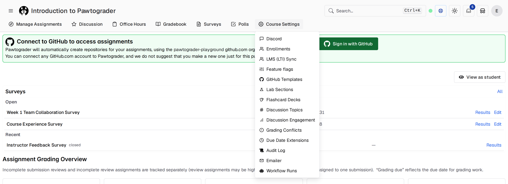

# Course Settings

**Course Settings** is a menu, not a page. Its trigger is a button with no link:
clicking it opens the menu and the address in your browser does not change. Every
course-wide setting lives on one of the menu's 15 entries, so this page is an
index — find the entry you want below, then follow the link for the details.

<Frame>
  
</Frame>

## The 15 entries

Routes are relative to `/course/<course_id>/`.

| Entry | Route | What it does | Documentation |
| --- | --- | --- | --- |
| **Discord** | `manage/discord` | Connects the course to a Discord server, so help requests and regrade requests post automatically to Discord channels. Also holds the **Calendar Integration** section, which auto-syncs every 5 minutes. | Not yet documented |
| **Enrollments** | `manage/course/enrollments` | The course roster table, plus a panel of university Student Information System (SIS) section links. | Not yet documented |
| **LMS (LTI) Sync** | `manage/course/lti` | Syncs rosters from your LMS and pushes assignment grades back over LTI 1.3. | Not yet documented |
| **Feature flags** | `manage/course/feature-flags` | Turns course features on or off. Navigation, dashboards, and student tools follow these flags. | [Feature flags](/staff/feature-flags) |
| **GitHub Templates** | `manage/course/github` | Overrides the handout and solution (grader) template repositories used when creating new assignment repos. Blank fields inherit your GitHub org's default, then the Pawtograder default. | Not yet documented |
| **Lab Sections** | `manage/course/lab-roster` | Shows which students are in each lab section, with a CSV export. Instructors get a **Manage lab sections** button that opens the lab section editor at `manage/course/lab-sections`. | [Lab sections](/staff/lab-sections) |
| **Flashcard Decks** | `manage/course/flashcard-decks` | Creates and manages flashcard decks for student practice, with per-deck, per-card, and per-student analytics. | [Flashcard decks](/staff/flashcard-decks) |
| **Discussion Topics** | `manage/discussion-topics` | Manages the topics students use to categorize discussion posts. | Not yet documented; [Discussion Board](/staff/discussion) covers how topics appear on the board |
| **Discussion Engagement** | `manage/discussion-engagement` | Tracks student participation and karma on the discussion board, with an export. | [Discussion Board](/staff/discussion) |
| **Grading Conflicts** | `manage/course/grading-conflicts` | Records conflicts of interest so staff are not assigned submissions they should not grade. | [Grading Assignments](/staff/assignments/grading-assignments) |
| **Due Date Extensions** | `manage/course/due-date-extensions` | Three tabs: **Assignment Exceptions** (the class-wide late token allotment, every due-date exception in the course, and **Gift Tokens**), **Student Extensions** (a student-wide extension across the course's assignments), and **Roster Tokens** (each student's token balance). Extensions for one assignment are usually granted from that assignment's own **Manage Due Date Exceptions** page. | [Extensions](/staff/assignments/extensions) |
| **Audit Log** | `manage/course/audit` | Records actions taken on assignments, due date exceptions, groups, discussion threads, and other course resources. | [Audit log](/staff/audit-log) |
| **Emailer** | `manage/course/emails` | Composes email to the whole class or a subset, with a preview step before sending. | [Emailer](/staff/emails) |
| **Workflow Runs** | `manage/workflow-runs` | Monitors GitHub Actions workflows, execution statistics, and grading errors across student submissions. | [Workflow runs](/staff/workflow-runs) |
| **Gemini API Key** | `manage/course/gemini-api-key` | Stores a course-owned Google Gemini API key for AI-assisted features such as exam OCR and template extraction. Requires the `gemini-api-key-setup` feature flag to be on before saving a key. | [Gemini API key](#gemini-api-key) |

<Note>
Two entries do not match the route they open, which matters if you are reading
URLs or bookmarking pages. **Lab Sections** opens `manage/course/lab-roster`, and
**Emailer** opens `manage/course/emails`.
</Note>

**Discussion Topics** and **Discussion Engagement** appear only when the
`discussion` feature flag is on for your course. Turn it on under
**Course Settings → Feature flags**.

### What graders see

A grader's menu is a subset of an instructor's. Graders see five entries:
**Discord**, **Lab Sections**, **Flashcard Decks**, **Discussion Engagement**,
and **Grading Conflicts**. The other ten — **Enrollments**, **LMS (LTI) Sync**,
**Feature flags**, **GitHub Templates**, **Discussion Topics**, **Due Date
Extensions**, **Audit Log**, **Emailer**, **Workflow Runs**, and **Gemini API
Key** — are instructor-only.

On **Grading Conflicts**, a grader sees only their own conflicts and is told to
contact an instructor about anyone else's. Instructors see the whole class.

## Course time zone

Each course has its own time zone, and every date and time rendered inside the
course uses it: due dates, deadlines, countdowns, date pickers, and timestamps.

The course time zone is **not editable from the course interface**. There is no
time zone field on any Course Settings entry. If your course needs a different
time zone, ask a Pawtograder administrator to change it. When a course has no
time zone configured, Pawtograder falls back to `America/New_York`.

Each viewer can switch their own display to their browser's local time zone
through **Time Zone Settings** in the user menu, and Pawtograder offers the
choice automatically on your first visit if the two time zones differ. The
preference is stored per browser in `localStorage`.

<Note>
Switching your display to your browser's local time zone affects only your own
browser. It does not change the course's configured time zone or what anyone else
sees.
</Note>

## Class late token policy

The class-wide late token allotment lives under **Course Settings → Due Date
Extensions → Assignment Exceptions**, in the **Class Late Token Settings** card.
Set **Late Tokens Per Student**, described in the form as "Number of late tokens
each student receives for the entire class".

How many of those tokens a student may spend on a single assignment is set per
assignment, as **Max late tokens** on the assignment form. Each token extends the
deadline by 24 hours.

An allotment of 0 turns late tokens off for the whole course, whatever each
assignment allows. To confirm students actually have tokens, see
[Extensions → Checking your setup](/staff/assignments/extensions#checking-your-setup).

The same entry's **Student Extensions** tab is where you grant one student a
blanket extension across the course's assignments — see
[Extensions → Granting a student-wide extension](/staff/assignments/extensions#granting-a-student-wide-extension).

See [Extensions](/staff/assignments/extensions) for the rest of the late token
and extension settings, including gifted tokens, and
[Late Tokens and Extensions](/students/assignments/late-tokens-and-extensions)
for how students spend them.

## Custom grader roles

Every course starts with four built-in roles: **instructor**, **grader**,
**student**, and **admin**. Instructors can create additional custom roles for
graders — for example, a "Head TA" role that can manage review assignments, or
a "Lab Leader" role that can publish groups.

### Capabilities

Each role is defined by a set of capabilities. The built-in instructor role
holds all capabilities; the built-in grader role holds none by default. Custom
roles are always grader roles and can hold any subset of the following
capabilities:

| Capability | What it allows |
| --- | --- |
| `manage_review_assignments` | See, create, edit, and delete review assignments for the class |
| `publish_groups` | Publish and manage student groups |
| `manage_assignments` | Create and edit assignments, sync repositories, and create student repos |
| `manage_roles` | Create, rename, and delete custom grader roles and set their capabilities |

A custom role always inherits everything the default grader role holds, plus
whatever capabilities you add. You cannot remove capabilities from the default
grader role itself.

<Note>
`manage_roles` lets a grader create and configure roles, but it does not let
them assign people to roles. Assigning someone to a role is always
instructor-only.
</Note>

### Creating a custom role

1. Open **Course Settings → Enrollments** (instructor-only).
2. Find the **Roles** section and click **Add role**.
3. Give the role a name and select the capabilities it should hold.
4. Click **Save**.

### Assigning a grader to a custom role

1. Open **Course Settings → Enrollments**.
2. Find the grader in the roster and click their row.
3. Under **Role**, select the custom role.
4. The change saves immediately.

Changing a grader's app role (for example, from grader to instructor) always
moves them to that role's default, overriding any custom role assignment.

### Deleting a custom role

A role that has at least one grader assigned to it cannot be deleted. Move
those graders to a different role first, then delete the role from the
**Roles** section of **Course Settings → Enrollments**.

## Grading conflicts

Course staff declare conflicts of interest so that they are not asked to grade
submissions where a conflict exists. Add one with **Add Conflict** under
**Course Settings → Grading Conflicts**. Graders can enter their own conflicts;
instructors can review and enter conflicts for everyone in the class.

See [Grading Assignments](/staff/assignments/grading-assignments) for how
conflicts affect grader assignment.

## Gemini API key

Each course can store its own Google Gemini API key for AI-assisted features
such as exam OCR and template extraction. The key is stored in Vault and is
never returned to the browser after it is saved — you cannot view it again
through Course Settings.

### Enabling the key setup page

Saving a key requires the `gemini-api-key-setup` feature flag to be on for
your course. Turn it on under **Course Settings → Feature flags**. The
**Gemini API Key** menu entry is always visible to instructors, but the save
and replace controls are disabled while the flag is off. You can still remove
a previously saved key with the flag off.

### Saving or replacing a key

1. Open **Course Settings → Gemini API Key**.
2. Type or paste your Gemini API key into the key field.
3. Click **Save** (first key) or **Replace** (updating an existing key).

The page shows whether a key is already configured and whether the
`gemini-api-key-setup` flag is on. It does not validate the key with Google
or turn on AI grading automatically — those steps depend on the specific
feature that uses the key.

<Note>
The key field uses `autocomplete="one-time-code"` to prevent browsers from
offering to save it as a password. The value is held only in the page's
component state and is cleared after every request completes.
</Note>

### Removing a key

Click **Remove** on the **Gemini API Key** page. Removal works whether or not
the `gemini-api-key-setup` flag is on. The key is deleted from Vault and
cannot be recovered.

<Warning>
Removing the key disables any course feature that depends on it, such as exam
OCR and template extraction. Re-enable those features by saving a new key.
</Warning>
