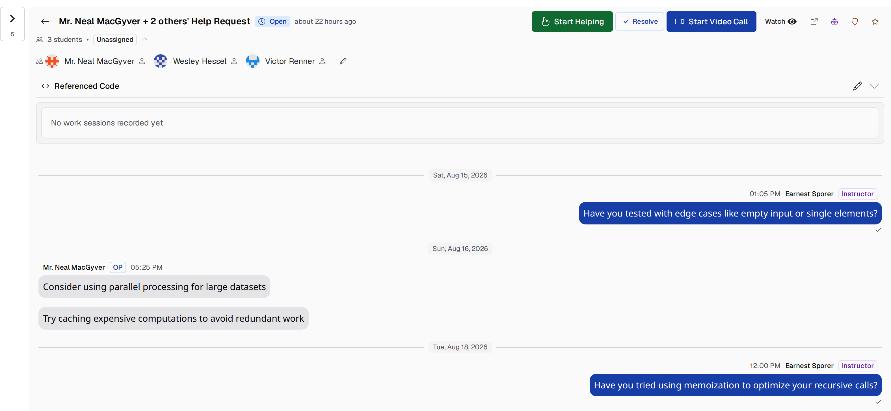

# Help Requests

A help request is one student question, or one group's question, from the moment it is filed until it is resolved. Open a request from the Working view, from All Requests, from search, or from the sidebar on any request page.

## Claiming and releasing

**Start Helping** assigns the request to you and moves it to in progress. Your name and a **Helping** badge appear for the student, along with a timer. That timer counts from the request's last update rather than from the moment you claimed it, so treat it as a rough figure and use [Time Tracking](/staff/office-hours/staffing-and-time-tracking#time-tracking) for real durations. **Stop** clears the assignee and returns the request to the queue as open.

Assignment is not exclusive. Any instructor or grader in the course can claim, resolve, or reassign any request, whether or not they are working that queue.

## The request view

<Frame>
  
</Frame>

The header carries the request title, its status, a **Private** badge when the request is private, and how long ago it was filed. Alongside **Start Helping** and **Resolve** you get:

- **Watch** and **Unwatch**, which control whether you receive notifications for this request.
- **Pop out chat**, which opens the conversation in its own window so you can keep the queue in view.
- **Get AI help**, which copies a prompt about this request to your clipboard.
- A Discord link, **Moderation**, and **Karma**, all staff-only. See [Moderation and Karma](/staff/office-hours/moderation-and-karma).
- **Start Video Call** when no call is running.

Below the header, a collapsible row labeled with the request's student count expands to the student list, the referenced code, and the work session history. A collapsible sidebar (**Show queue requests**) lists the rest of that queue in three groups: **Working** for requests assigned to you that are still active, **Open** for everything else unresolved, and **Resolved** newest first. Unread-message counts appear only on requests assigned to you.

## Students and referenced code

**Edit student list** adds or removes students on a request, subject to at least one student remaining. Use it to merge two students who came to office hours with the same question into one conversation.

Students can attach a submission, specific files from it, and line numbers, and staff see those references inline. **Edit code references** lets you change them.

<Warning>
Referencing a submission forces the request private, and clearing the last reference forces it public again. Removing a student's code references from a request that was private for that reason will publish it to the class, so leave at least one reference in place if the conversation should stay private. The picker also lists your own submissions rather than the student's, so it is more useful for reviewing and removing references than for adding them. This is a known issue with an open report against Pawtograder, and a fix is on the way.
</Warning>

## Video calls

Only instructors and graders see **Start Video Call**, and it works on any queue whatever the queue's type. Once a call is live, everyone who can see the request gets **Join Video Call** and staff also get **End Call**.

<Warning>
End the call before you resolve the request. Both **Join Video Call** and **End Call** are disabled once a request is resolved or closed, which leaves the meeting running with no way to shut it down from the interface. The command-line tool refuses to close a request with a live call for the same reason.
</Warning>

## Work session history

Pawtograder records a work session automatically whenever a request is assigned, and closes it when the request is unassigned, handed to someone else, or resolved. Each session stores the queue depth and the longest wait in the queue at the moment it opened, which is the context you want when reading a long session later.

The panel lists sessions newest first with the TA, duration, queue depth, and start and end times, and totals them when there is more than one. Instructors can delete a session. The edit button reports that editing is coming soon.

The same sessions drive the course-wide dashboard described in [Staffing and Time Tracking](/staff/office-hours/staffing-and-time-tracking).

## Escalating a ticket

While you are helping a student, a purple **Escalate** button appears next to **Resolve**. Use it when you cannot finish the question yourself and want to hand it to another staff member.

Clicking **Escalate** opens a short note field (up to 500 characters, staff-only). Write what you tried and what is still unresolved, then confirm. The ticket returns to the queue as open, but it sorts **above every normal ticket** so the student does not restart at the back of the line. A purple **Escalated** badge marks it, and the queue row previews your note.

When another staff member opens the escalated ticket, a history panel shows who already helped, how long the student has waited in total, and every escalation note, so the student does not have to explain again.

Students can also escalate their own ticket. When you press **Resolve**, the student gets a 10-minute check-in: "Did your problem get fixed?" If they answer **No**, they write what they are still stuck on and the ticket is escalated automatically. If they answer **Yes**, or do not answer within 10 minutes, the ticket stays resolved.

## Ending a ticket

The red **End ticket** button closes a ticket permanently. There is no check-in, nobody can escalate it again, and the student cannot reopen it. Use it when more help will not fix the problem — wrong queue, a question for the instructor outside office hours, or a student who has already left.

You can also end a ticket you have already resolved, during its check-in window, to withdraw the check-in.

<Warning>
End the video call before you resolve or end a ticket. Both **Resolve** and **End ticket** are disabled while a call is running.
</Warning>

### Resolve vs End ticket

| | Resolve | End ticket |
| --- | --- | --- |
| Student check-in | Yes, 10 minutes | No |
| Can be escalated afterwards | Yes, if the student says No | Never |
| Use when | You think it is fixed | It is done, whether or not it is fixed |

## What's new walkthrough

The first time a staff member opens the office hours manage view, a **New in Office Hours: ticket escalation** dialog appears. It offers a five-step tour of escalation, the escalated-ticket view, the Resolve check-in, End ticket, and the Resolve vs End ticket comparison. Closing the dialog skips the tour; **Show me** starts it.

A **What's new** button in the queue header reopens the tour at any time. The tour is staff-only; students never see it.

## Resolving

| Status | Meaning |
| --- | --- |
| `open` | Filed, unclaimed, still in the queue. |
| `in_progress` | A staff member has claimed it. |
| `resolved` | Finished. Removed from the open list. The student gets a 10-minute check-in. |
| `closed` | Also finished, and treated exactly like `resolved` in every list. |

Any instructor or grader, and any student named on the request, can resolve it. Students pick a reason when they do (see [Resolving and Feedback](/students/office-hours/resolving-and-feedback)); staff do not get that dialog.

<Note>
When staff resolve a request, no resolution status or note is recorded, only who resolved it and when. If you want data on how requests actually ended, ask students to resolve their own.
</Note>

Nothing in the web interface sets `closed`. The only route to it is `pawtograder help-requests close`, which is instructor-only and defaults to that status. See [Command Line Interface](/staff/cli).

Once a request is resolved or closed, its chat becomes read-only for everyone and reads "This is a historical chat view. New messages cannot be sent."

## Student feedback

Instructors get **Help Request Feedback** under **Settings → Feedback**, which collects the thumbs-up and thumbs-down ratings students leave when they resolve a request, along with any comment. Counters at the top give total, positive, negative, and how many carry a comment. You can search by comment or student name, filter to positive or negative, and open the request each rating came from.

Feedback is not anonymous: each card names the student. Graders cannot see this page or its data.

## Notifications

Two separate mechanisms tell staff about queue activity.

In-app notifications reach every instructor and grader in the course when a request is created, regardless of who is watching it or which queues they work. Demo queues send nothing. Notifications about later events, new messages and status or assignment changes, go only to users watching that request, and picking up a request does not start you watching it.

<Tip>
Press **Watch** on a request you are helping. Only the student who filed a request is watched automatically, so without it you will not be notified of their replies.
</Tip>

Browser notifications, the sound alert, the flashing tab title, and the favicon badge fire only while the tab is in the background, and only for other people's messages. Configure them from **Notification Settings** in your user menu.

## AI help

On a request, the **Get AI help** button copies a prompt to your clipboard that names the request, the class, and any referenced submission, and tells an assistant which Pawtograder MCP tools to call for the details. Paste it into an MCP-connected assistant. No model is called from Pawtograder itself, and if you have no API token yet the button opens setup instructions instead. Only instructors and graders see it. See [AI Assistance](/staff/ai-assistance) for the server, the tokens, and the available tools.

## See also

- [Office Hours Overview](/staff/office-hours/intro) for All Requests and the search page.
- [Office Hours for Students](/students/office-hours) for what the student sees on the other side of the same request.
