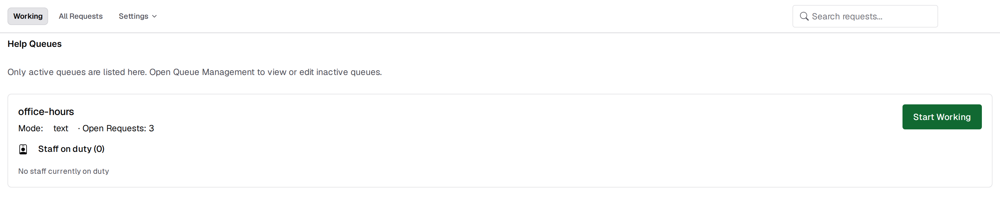

# Running Office Hours

Staff put themselves on duty one queue at a time. Nobody schedules you here: you start working a queue when your shift begins, and stop when it ends.

## Going on duty

<Frame>
  
</Frame>

Open **Working**. Under the **Help Queues** heading, each queue shows its mode, its count of unresolved requests, who is on duty, and a green **Start Working** button. Only queues marked active appear here; the page says so and points you at Queue Management for the rest. See [Queue Configuration](/staff/office-hours/queue-configuration#available-active-and-who-sees-what) for what the active flag does on each surface.

Starting work puts you on duty for that queue. Other staff see you in the queue's staff-on-duty list, students see the queue as staffed, and the queue becomes selectable in the student **New Request** menu. You can work several queues at once. **Stop Working** on a queue card ends that one assignment; **Stop Working (n)** in the header ends all of them at once.

Once you are on duty, **Working** stops listing queues and lists the requests you are responsible for instead. [Help Requests](/staff/office-hours/help-requests) covers what to do with one.

## Queue health cards

When the **office-hours-queue-health** course feature flag is on, each queue card on the staff dashboard shows additional health information:

- **Waiting count** — the number of open requests currently waiting.
- **Oldest wait** — how long the longest-waiting request has been in the queue.
- **Unstaffed badge** — shown when no TA has an active shift on that queue.

Cards are sorted so queues that need attention appear first: queues that have exceeded the red threshold come before those that have not, and unstaffed queues with waiting requests are surfaced prominently.

### Red thresholds

Instructors can set per-class thresholds under **Queue Settings**. When the number of open requests on a queue reaches the configured threshold, the card turns red. The threshold is a count of open requests; the default is no threshold (no red state).

### Red-queue alert

When a queue first turns red, instructors receive one browser notification. The notification fires once per threshold crossing, not continuously. Browser notifications must be allowed for the site; the **Notifications are blocked** banner tells you if they are not.

## Turn alerts

When the **turn-alert** course feature flag is on, students receive a browser notification when:

- A TA picks up their request (the request moves to **In Progress**).
- They are next in line in the queue.

Alerts fire once per event. Students must allow browser notifications for the site to receive them.

## Shift-end release

When the **shift-end-release** course feature flag is on, ending a shift automatically returns any in-progress requests assigned to you back to the queue. This prevents requests from being stranded when a TA's shift ends while they are still helping a student.

If you end a shift on one queue but still have an active shift on another, requests on the ended queue are returned to the queue. Requests on queues where you still have an active shift are unaffected.

<Note>
Starting work always records a concurrent-student limit of `1`. There is no control for changing it, and it does not limit how many requests can be routed to you at once. Assignment Management displays the value. This is a known issue with an open report against Pawtograder, and a fix is on the way.
</Note>

## Staffing times and the schedule

Each queue card lists the staff currently on duty, the end time of the shift in progress with the time remaining, and the start of the next scheduled shift. Those times come from the course's office hours calendar, not from the assignment rows: an event counts toward a queue when it is explicitly linked to the queue, or when the event's queue name matches the queue's name, ignoring case. With nobody on duty the card reads "No staff currently on duty".

When the course has an office hours or events calendar configured, a **Today's Schedule** strip appears above the queue list with buttons for the previous day, today, and the next day. Set the calendar under **Course Settings → Discord**, in the Calendar Integration section. See [Course Settings](/staff/course-settings).

## Two banners you may see

A **Real-time updates disconnected** warning means queue status and new requests may be stale until the connection recovers. A **Notifications are blocked** warning means the browser has denied notification permission, so you will not be alerted to new student messages; the banner tells you to allow notifications from the lock icon in the address bar.

## See also

- [Staffing and Time Tracking](/staff/office-hours/staffing-and-time-tracking) for the record of shifts you have worked and the per-TA time dashboard.
- [Office Hours Overview](/staff/office-hours/intro) for the header, the Settings menu, and finding any request.
