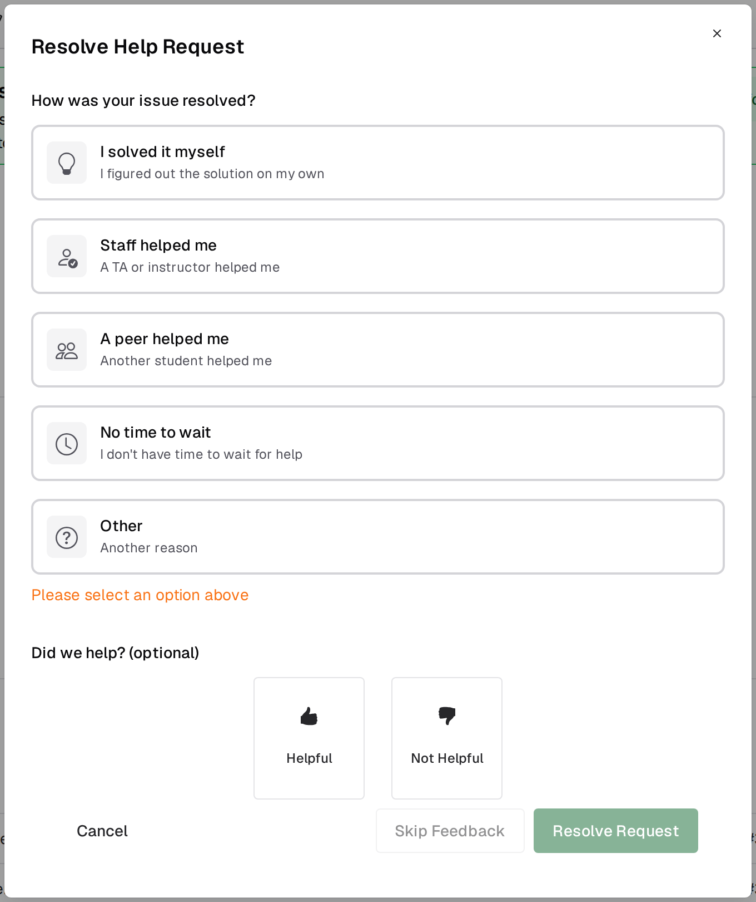

# Resolving and Feedback

## Resolving Your Help Request

Resolve your own request from the **Resolve** button in the request header, which asks you to confirm first, or from the check-mark button on the floating widget, which opens the dialog straight away. Pick the status that fits:

- **I solved it myself**
- **Staff helped me**
- **A peer helped me**
- **No time to wait**
- **Other**, which asks you for a note

The same dialog offers an optional thumbs-up or thumbs-down with a comment. If you skip it, a **Feedback** button stays on the resolved request so you can leave it later. Instructors can read this feedback and so can you; graders cannot.

<Frame>
  
</Frame>

<Note>
Staff can also mark your request resolved. When they do, no resolution status is recorded for it.
</Note>

### Check-in after staff resolve

When the course has the escalation feature enabled, staff resolving a request that was in progress opens a 10-minute check-in for you. A dialog asks whether your problem was fixed:

- **Yes** — the request stays resolved.
- **No** — you can add a note, and the request goes back to the queue as escalated so another TA can pick it up with context.

If the check-in expires before you answer, the request stays resolved. You can also skip the check-in if you are done.

Once a request is resolved or closed, its chat becomes read-only, so save anything you still need from the conversation before you resolve.

## See also

- [During Your Request](/students/office-hours/during-a-request) for the request page and its chat.
- [Office Hours](/students/office-hours) for browsing queues and reading resolved requests from your classmates.
